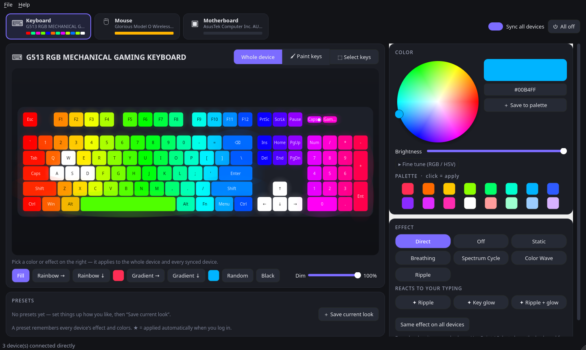

# RGB Deck

[](https://github.com/dancingduck425/rgbdeck/actions/workflows/ci.yml)


Standalone RGB lighting control for Linux and Windows. Talks to your devices **directly** with its own drivers —
USB peripherals over HID, Govee room lights over your local network — no vendor software, no cloud account, no
background daemon, no third-party RGB software.

- **Per-key painting** on a drawn keyboard, selection tools, gradients, rainbow, dim.
- **Effects** chips (device onboard effects with speed / brightness / direction / colors).
- **Typing effects**: ripple & key glow rendered on top of your colors.
- **Sync all devices**: one click colors keyboard + mouse + motherboard + room lights.
- **Govee lights** on your Wi-Fi: color, per-segment painting, whites, built-in scenes, and a pulse on every
  key press while a typing effect runs.
- **Presets**, apply-at-login, tray icon, single instance.
- **Close it and the colors stay**: on exit the look is stored in each device's own memory (single color or
  onboard effect), and multi-color key layouts are re-applied at login. The app doesn't need to keep running
  unless you use a typing effect.



## Supported hardware

Every driver is native (`rgbdeck/hw/`). The first three were developed and verified on real hardware; the rest
were ported byte-for-byte from GPL-2.0 driver sources with packet-level unit tests, but have **not yet been run
on physical devices** — they are marked *experimental*. If you own one, please try it and open an issue either way.

| Family | Devices | Status |
|---|---|---|
| Logitech HID++ 2.0 keyboards | G512, G513, G810, G815, G910, G915/TKL, PRO… (keys discovered from the device; ANSI/ISO/JIS) | verified |
| Glorious wireless mice | Model O / O- / D / D- Wireless, cable or dongle (all 3 onboard profiles, battery) | verified |
| ASUS Aura USB mainboards | 0b05:19af and relatives (direct color + onboard effects) | verified |
| Razer Chroma | 182 keyboards, Blade laptops, mice, mousepads, keypads, headsets, accessories; paired devices through receivers | experimental |
| Logitech mice & headsets | G203/G303/G403/G502/G703/G900/G903/G Pro families, G633/G635/G733/G933/G935; Lightspeed, Powerplay and Unifying receivers | experimental |
| Corsair peripherals | K55/K65/K68/K70/K95/Strafe, M65/Scimitar/Glaive/Harpoon/Ironclaw/Nightsword/Dark Core, MM800, ST100, and the newer iCUE "V2" keyboards/mice/mousemats | experimental |
| Corsair Lighting Node / Commander | Lighting Node PRO & CORE, Commander PRO LED channels, LS100, LT100, 1000D, SPEC OMEGA (set your LED count per channel in the app) | experimental |
| SteelSeries | Rival 100–710, Rival 3/5, Sensei, Aerox 3/5/9, Apex 3/5/7/9/Pro/TKL/M750, Arctis 5/Nova 3, Siberia 350, QcK Prism | experimental |
| Govee Wi-Fi lights (LAN API) | Any model with the "LAN Control" switch in the Govee Home app: on/off, brightness, color, whites. 272 models have their segment counts and firmware scenes built in (H618x/H619x strips, Glide, TV backlights, bulbs, lamps…). Bluetooth-only models are not supported | experimental |
| HyperX | Alloy Origins/60/65/Core/Elite/Elite 2/FPS, Pulsefire Surge/Core/FPS Pro/Dart/Raid/Haste, Fury Ultra & Pulsefire mats, QuadCast S/2 S, DuoCast | experimental |

Not supported on purpose: RAM and GPU lighting (driven over I²C/SMBus, where a bad write can brick a module — not
something to ship untested). Everything else: see [CONTRIBUTING.md](CONTRIBUTING.md) for how to add a driver, or
open a device-support issue with your `lsusb` line.

### Govee lights

1. In the **Govee Home** app open the light, tap the settings gear and switch on **LAN Control**. (Not every
   model has it; Bluetooth-only lights don't.)
2. Keep the light on the same network as the PC. RGB Deck finds it within half a minute and remembers it.
   The **💡 Lights** button next to the device cards lists every light with its state and says what is wrong
   when one is not connected ("on your network, but LAN Control is off", "not reachable", …).
3. If it doesn't show up: a firewall is probably dropping the light's answers. Allow incoming UDP port 4002
   from your LAN (`sudo ufw allow proto udp from 192.168.0.0/16 to any port 4002`), or press **Search my network**
   in the Lights panel. It asks every address on your LAN directly (no multicast needed), recognises Govee
   hardware by its network card even when LAN Control is still off, and tells you which of the two it is.
   You can also type an address there yourself.

On Windows, looking for lights is off until you tick **Settings → Find Govee lights on my network**, because
Windows then asks once whether RGB Deck may use your network.

The light shows up as one more device: paint its segments like keys (or set the LED count to 1 to treat it as a
single lamp), pick a white or one of its own scenes from the effect chips, and it follows *Sync all devices*.
Everything is sent locally over UDP; nothing goes to Govee's cloud. The light keeps whatever you set after the
app is closed.

## Install

### Linux

```sh
git clone https://github.com/dancingduck425/rgbdeck.git ~/src/rgbdeck && cd ~/src/rgbdeck
./install.sh            # user install; asks sudo once for the udev rule
# Arch:  makepkg -si     # proper package
# any:   pipx install .  # pulls PySide6 from PyPI
```

Dependencies: Python ≥ 3.10, PySide6. Optional: `python-evdev`.

Device access: `70-rgbdeck.rules` (generated from every driver's USB ID list by `tools/gen_udev_rules.py`) grants the logged-in user access via `uaccess`. Replug the device
(or reboot) after installing the rule. Typing effects read `/dev/input/event*`, which logind already
grants to the active seat.

### Windows

Download **`RGBDeck-Setup-<version>.exe`** from the [latest release](https://github.com/dancingduck425/rgbdeck/releases/latest)
and run it (there is also a portable `RGBDeck.exe` that needs no install). Nothing else to set up: Windows
talks to the devices through [hidapi](https://github.com/libusb/hidapi), no driver or rule needed.

- The build is not code-signed, so SmartScreen warns the first time: *More info → Run anyway*.
- **Quit the vendor software first** (Logitech G HUB, ASUS Armoury Crate, Glorious Core, Corsair iCUE,
  Razer Synapse, SteelSeries GG, HyperX NGENUITY) — including its tray icon. It keeps the device open, and
  Windows lets only one program talk to it.
- From source instead: `pip install .` (pulls PySide6 and hidapi), then `python -m rgbdeck`.

Windows support is new in 1.2.0. It runs exactly the same drivers, and the build is unit-tested and
smoke-tested on CI, but the three verified devices were verified on Linux. If you try it, please open an
issue saying what worked.

## Run

```sh
rgbdeck                      # GUI (second launch just raises the window)
rgbdeck --apply "My look"    # apply a preset headless (used by "apply at login")
rgbdeck --list               # list presets
rgbdeck --verbose            # log to the terminal; log file is ~/.config/rgbdeck/rgbdeck.log
                             #   (Windows: %APPDATA%\rgbdeck\rgbdeck.log)
```

Don't run another RGB control program (vendor software etc.) at the same time — two programs talking to
the same keyboard confuse each other.

## Troubleshooting

| Symptom | Fix |
|---|---|
| "Found devices but can't access them" | Install the udev rule once, then unplug/replug: `sudo install -m644 rgbdeck/data/70-rgbdeck.rules /etc/udev/rules.d/ && sudo udevadm control --reload && sudo udevadm trigger` |
| Windows: "can't access" / nothing changes | Another program owns the device. Quit the vendor software (G HUB, Armoury Crate, Glorious Core, iCUE, Synapse…) including its tray icon, then **File → Rescan devices**. |
| Device not listed | Only families in the table above are detected. Close any other program that talks to the device (vendor software, OpenRGB…) — two controllers confuse the hardware. Then **File → Rescan devices**. |
| Glorious mouse ignores colors | Its lighting is stored per onboard profile (1–3) and most tools only write profile 1. RGB Deck writes all three; if it still ignores you, press the profile button once. While on its cable the mouse still shows your colors — a solid color after charging is just the profile it is on. |
| Govee light not found | Switch on **LAN Control** for it in the Govee Home app, same network as the PC, and let incoming UDP 4002 through the firewall — or add its address in **Settings → Network lights**. Another program on this PC that listens on that port (Govee Desktop, Home Assistant) also takes the answers away. |
| Govee segments show wrong / nothing | Set **LED count** to 1 to drive it as one light, and please open an issue with the model number. |
| Typing effects don't react | They read `/dev/input/event*`. logind grants that to the active session; otherwise add your user to the `input` group. The hint under the effect chips says which input devices are being listened to. |
| Keyboard flickers / lags while dragging the wheel | Frames are capped per device (Logitech ≈ 20 fps). If another program is also writing to the keyboard, close it. |
| Something else | `rgbdeck --verbose` prints to the terminal; the log is at `~/.config/rgbdeck/rgbdeck.log`. Open an issue with the log and your `lsusb` line. |

## Resource use

Measured on the author's machine (Plasma, three devices): 0.0 % CPU idle, about 1 % of one core while a
typing effect is rendering at 24 fps. Unique memory about 45 MB (the larger "RSS" figure in task managers
is mostly Qt / desktop libraries shared with other apps). `rgbdeck --apply` (what the login entry runs)
needs no Qt at all, ~20 MB, and exits once the look is applied.

## Keyboard shortcuts

`1` / `2` / `3` whole-device / paint / select · `F` fill · `Ctrl+A` select all · `Ctrl+I` invert · `Esc` clear ·
right-click a key to pick its color · `Ctrl+Q` quit.

## Tests

`tests/` drives the real hardware offscreen (stop the GUI first):

```sh
python3 tests/functional_test.py /tmp/out
python3 tests/effect_test.py /tmp/out
```

## License

Copyright (C) 2026 dancingduck425. Released under the GPL-2.0-only (see [LICENSE](LICENSE)).

The experimental drivers are ports of OpenRGB's GPL-2.0-or-later controllers, so they remain under the
GPL; each ported module names the OpenRGB source files it came from.

## Protocol credits

Device protocols were learned from the driver sources of [OpenRGB](https://gitlab.com/CalcProgrammer1/OpenRGB)
(GPL-2.0-or-later) and [korkje/mxw](https://github.com/korkje/mxw) (MIT). The Govee driver follows Govee's public LAN API
guide; its per-model table (segment counts, scene codes) was compiled from
[govee-local-api](https://github.com/Galorhallen/govee-local-api) (Apache-2.0). RGB Deck does not use or depend on any
of them at runtime.
